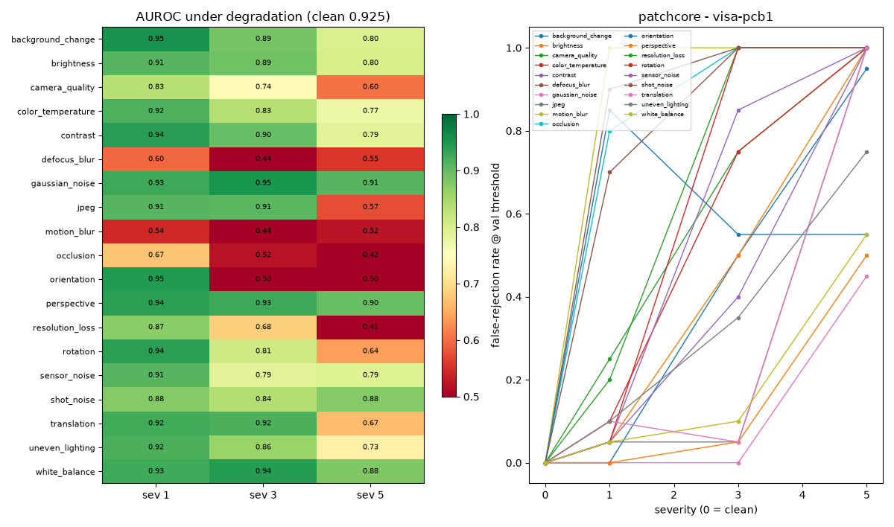

# Model card and evaluation report

All numbers below were **measured** on the **held-out test split**, which was never used for training,
threshold selection or calibration. Detection metrics were first measured on Debian 13, Python 3.13,
PyTorch 2.14.1 CPU, 2 vCPU, about 2 GB RAM, no GPU, and then re-measured from scratch on Windows 11,
Python 3.14.8, the same PyTorch CPU build, an Intel i7-12700H (14 cores) and 16 GB RAM. Every VisA pcb1
metric reproduced exactly; only latency differs between the two machines. Commands to reproduce them are
at the end. No number on this page was copied from a paper.

## Intended use

- **Use**: flag visually anomalous parts on a fixed inspection station (fixed camera, lighting and part
  pose), routing uncertain cases to a human. One model per product type.
- **Not for**: fully automatic release of safety-critical parts without human review; stations whose
  lighting, camera or pose changes without retraining (see *Domain shift*); defect *measurement* or
  metrology; defect types that are not visible in the image.
- **Users**: quality inspectors (review), quality engineers/admins (thresholds, training, activation).

## Models

| Algorithm | Training data | Output | Weights |
|---|---|---|---|
| PatchCore (in-house) | normal images only | anomaly map + image score (max of map) | ImageNet ResNet-18 backbone (torchvision; downloaded at runtime) + memory bank |
| PaDiM (in-house) | normal images only | anomaly map + image score | ResNet-18 backbone + per-position Gaussians |
| PixelStats (baseline) | normal, aligned images | z-score map + score | none (no deep learning) |
| Defect-type classifier | anomalous images with *genuine* type annotations | type or "unknown" | small MLP on region embeddings |

Implementation details are in [`ARCHITECTURE.md`](ARCHITECTURE.md#models-defectmlmodels). Each model
directory stores its config, thresholds, training history, data provenance (dataset name, version,
manifest hash), validation and test metrics, and peak memory.

### Thresholds and decision policy

- `fail` = Youden-J optimum on the **validation** split. An F1-optimal threshold was tried first and was
  degenerate on small validation sets: it rejected nearly all normals. With Youden, PatchCore's test
  false-reject rate fell from 0.949 to 0.051 (capsules) and from 0.438 to 0.000 (cashew).
- `pass` = min(threshold keeping 98 % validation recall, `fail` − 25 % of the normal score range). Scores
  between `pass` and `fail` go to **REVIEW**.
- PASS additionally requires: image quality OK, not out-of-distribution, and (if configured) no
  disagreement from a secondary model. Errors never PASS.
- **Auto-PASS miss rate** = fraction of truly defective test images that the full policy auto-PASSed: the
  number that matters most for escapes.

## Results: held-out test split

Columns: image AUROC with bootstrap 95 % CI; AP; then F1, recall and false-reject rate (FRR) at the `fail`
threshold; auto-PASS miss rate and review rate under the full policy; pixel AUROC; AUPRO (normals included);
CPU latency per image. n = number of test images.

| Product (n) | Model | AUROC [95 % CI] | AP | F1 | Recall | FRR | Auto-PASS miss | Review | Pixel AUROC | AUPRO | ms/img |
|---|---|---|---|---|---|---|---|---|---|---|---|
| **VisA pcb1** (130) | PaDiM | 0.914 [0.860–0.958] | 0.890 | 0.859 | 0.892 | 0.185 | 0.031 | 0.092 | 0.988 | 0.862 | 32 |
| | PatchCore | 0.883 [0.821–0.935] | 0.877 | 0.680 | 0.538 | 0.046 | 0.092 | 0.331 | 0.987 | 0.832 | 144 |
| | PixelStats | 0.839 [0.776–0.901] | 0.783 | 0.701 | 0.631 | 0.169 | 0.031 | 0.369 | 0.807 | 0.392 | 2.4 |
| **VisA cashew** (97) | PatchCore | 0.975 [0.945–0.996] | 0.989 | 0.879 | 0.785 | 0.000 | 0.031 | 0.247 | 0.992 | 0.888 | 86 |
| | PaDiM | 0.905 [0.838–0.957] | 0.953 | 0.736 | 0.600 | 0.062 | 0.000 | 0.485 | 0.987 | 0.845 | 32 |
| | PixelStats | 0.818 [0.708–0.919] | 0.874 | 0.884 | 1.000 | 0.531 | 0.000 | 0.021 | 0.719 | 0.119 | 2.5 |
| **VisA capsules** (104) | PatchCore | 0.739 [0.649–0.828] | 0.848 | 0.527 | 0.369 | 0.051 | 0.031 | 0.731 | 0.964 | 0.623 | 99 |
| | PaDiM | 0.599 [0.498–0.710] | 0.730 | 0.695 | 0.754 | 0.692 | 0.015 | 0.260 | 0.912 | 0.514 | 38 |
| | PixelStats | 0.555 [0.445–0.663] | 0.709 | 0.681 | 0.738 | 0.718 | 0.077 | 0.202 | 0.844 | 0.427 | 3 |
| demo-pcb, SYNTHETIC (68) | PaDiM | 1.000 | 1.000 | 0.941 | 0.889 | 0.000 | 0.028 | 0.044 | 0.997 | 0.956 | 37 |
| | PatchCore | 0.989 | 0.990 | 0.928 | 0.889 | 0.031 | 0.056 | 0.059 | 0.994 | 0.942 | 50 |
| | PixelStats | 0.885 | 0.935 | 0.875 | 0.778 | 0.000 | 0.111 | 0.397 | 0.943 | 0.808 | 2.4 |
| demo-metal, SYNTHETIC (68) | PaDiM / PatchCore | 1.000 | 1.000 | 1.000 | 1.000 | 0.000 | 0.000 | 0.000 | 0.99 | 0.95 | 34 / 46 |
| | PixelStats | 0.884 | 0.911 | 0.733 | 0.611 | 0.062 | 0.111 | 0.309 | 0.883 | 0.762 | 2.5 |

- **Peak process memory** during training/evaluation: 688–1033 MB on the 2-vCPU Linux machine (`peak_memory_mb`
  in each model's metrics; resident set size, so it includes PyTorch itself). Windows does not expose this
  counter through Python's `resource` module, so it is `null` there.
- **Windows re-run (Visual comparison of latency).** The same three pcb1 models measured 38.9 ms (PaDiM),
  93.2 ms (PatchCore) and 11.5 ms (PixelStats) per image in the in-app benchmark on the i7-12700H, i.e.
  throughput of 18.0 / 9.3 / 37.6 images/s. The latency column above is from the 2-vCPU Linux run.
- **Throughput** (in-app Evaluation, pcb1, batch, 2-vCPU Linux): PixelStats 86.4, PaDiM 22.2, PatchCore 7.3 images/s.
- **ONNX export parity** (PatchCore/PaDiM, PyTorch vs ONNX Runtime): max abs. score difference ≤ 2.4e-6 on
  VisA models and 1.2e-6 on synthetic PatchCore. Checked automatically on every export.
- **Reproducibility check**: after a clean-machine rebuild of the demo (`defectlens bootstrap-demo`, 106 s),
  AUROC, F1, recall, FRR, auto-PASS miss, review rate and pixel AUROC matched the table to all three
  decimals. **VisA pcb1 was re-verified from scratch twice**: first on Linux (fresh download,
  `prepare-visa`, then `train-visa` for all three models, 214 s total on 2 CPUs), then again on Windows 11 /
  Python 3.14.8 from a fresh download and a fresh database (training 268 s; PatchCore 148 s, PaDiM 105 s,
  PixelStats 15 s). Every value in the pcb1 rows (AUROC and its CI, AP, F1, recall, FRR, auto-PASS miss,
  review rate, pixel AUROC, AUPRO) matched to all three decimals on both runs. Training is deterministic
  (fixed seeds, fixed splits). Latency is the only column that changes with hardware. The capsules and
  cashew rows were not re-run after the sandbox resets.

### Reading these numbers honestly

- **Small test sets.** n = 97–130 per VisA category, so a 0.03 AUROC difference is often within the CI
  (see pcb1 PaDiM vs PatchCore). The CIs are bootstrap intervals over test images.
- **Below published results.** The PatchCore paper reports higher VisA AUROCs with a WideResNet-50
  backbone at higher resolution. These models use ResNet-18 at 224 px, chosen to train and run in about
  1 GB of RAM on 2 CPU cores, plus a bounded memory bank. Expect better numbers with a larger backbone on
  better hardware. On pcb1, PaDiM beat PatchCore in this configuration.
- **capsules is hard**: many small, low-contrast defects on cluttered, randomly placed capsules. PatchCore
  sends 73 % of capsule images to REVIEW. That's the policy doing its job (not auto-deciding what it
  can't separate), but it means little automation for that product without a better model.
- **pcb1 PatchCore auto-PASS miss 9.2 %**: 6 of 65 defective boards were auto-passed. In this configuration
  PaDiM is the safer pcb1 choice (3.1 %). Model lab shows this comparison before activation.
- **Calibrated probability**: Platt scaling fitted on the small validation split. It saturates (> 99.9 %)
  for clear anomalies and should be read as a rough guide, not a precise defect likelihood.
- **Synthetic results are not evidence** of real-world accuracy. They verify that the pipeline works.

## Robustness (VisA pcb1, PatchCore, 40 test images: 20 normal / 20 anomalous)

All 19 image corruptions in the library, each at severities 1, 3 and 5 (57 conditions), with thresholds
fixed (not re-tuned). Clean subset: AUROC 0.925, recall 0.55, FRR 0.00. Overall robustness score (mean
degraded AUROC / clean AUROC): **0.8413**. Runtime 368 s on the 2-vCPU Linux machine; re-run from scratch
through the app's background job on Windows 11 / Python 3.14 it took 272 s and produced the same score and
the same clean metrics. The earlier 8-degradation run reproduced exactly within this one (same per-image
seeds).



AUROC and FRR are at the `fail` threshold. **Auto-PASS of defects** is the count of the 20 defective boards
that the *full* decision policy (pass/fail thresholds, OOD and quality checks) would auto-PASS, measured by running
every degraded image through the same `Inspector` the app uses.

| Degradation | AUROC s1 / s3 / s5 | FRR s1 / s3 / s5 | Robustness score | Auto-PASS of defects (s1/s3/s5) |
|---|---|---|---|---|
| Gaussian noise | 0.927 / 0.950 / 0.910 | 0.00 / 0.00 / 0.45 | 1.00 | 0 / 0 / 0 |
| Perspective | 0.938 / 0.927 / 0.897 | 0.00 / 0.05 / 0.50 | 1.00 | 0 / 0 / 0 |
| White balance | 0.925 / 0.943 / 0.880 | 0.05 / 0.10 / 0.55 | 0.99 | 0 / 0 / 0 |
| Background change | 0.955 / 0.885 / 0.797 | 0.00 / 0.50 / 0.95 | 0.95 | 0 / 0 / 0 |
| Contrast | 0.940 / 0.900 / 0.787 | 0.05 / 0.85 / 1.00 | 0.95 | 0 / 0 / 0 |
| Brightness | 0.910 / 0.893 / 0.802 | 0.05 / 0.50 / 1.00 | 0.94 | 0 / 0 / 0 |
| Shot noise | 0.875 / 0.838 / 0.875 | 0.70 / 1.00 / 1.00 | 0.93 | 0 / 0 / 0 |
| Colour temperature | 0.915 / 0.835 / 0.775 | 0.10 / 0.75 / 1.00 | 0.91 | 0 / 0 / 0 |
| Translation | 0.923 / 0.917 / 0.665 | 0.10 / 0.05 / 1.00 | 0.90 | 0 / 0 / 0 |
| Uneven lighting | 0.917 / 0.857 / 0.728 | 0.10 / 0.35 / 0.75 | 0.90 | 0 / 0 / 0 |
| Sensor noise | 0.910 / 0.787 / 0.792 | 0.05 / 0.40 / 1.00 | 0.90 | 0 / 0 / 0 |
| JPEG compression | 0.910 / 0.907 / 0.575 | 0.05 / 0.05 / 1.00 | 0.86 | 0 / 0 / 0 |
| Rotation | 0.938 / 0.810 / 0.640 | 0.05 / 1.00 / 1.00 | 0.86 | 0 / 0 / 0 |
| Camera quality | 0.833 / 0.745 / 0.605 | 0.25 / 0.75 / 1.00 | 0.79 | 0 / 0 / 0 |
| Resolution loss | 0.870 / 0.685 / 0.408 | 0.20 / 1.00 / 1.00 | 0.71 | 0 / 0 / 0 |
| Orientation (s1 mirror, s3/s5 180°) | 0.945 / 0.497 / 0.497 | 0.85 / 0.55 / 0.55 | 0.70 | 0 / 0 / 0 |
| Occlusion | 0.672 / 0.520 / 0.422 | 0.80 / 1.00 / 1.00 | 0.58 | 0 / 0 / 0 |
| Defocus blur | 0.597 / 0.440 / 0.555 | 0.90 / 1.00 / 1.00 | 0.57 | 0 / 0 / 0 |
| Motion blur | 0.542 / 0.440 / 0.522 | 1.00 / 1.00 / 1.00 | 0.54 | 0 / 0 / 0 |

For comparison, on the clean images the policy auto-PASSes 1 of the 20 defective boards (consistent with the
9.2 % auto-PASS miss on the full test split).

Findings:

- **Most corruptions fail in the safe direction.** They raise anomaly scores, so the model *rejects good
  parts* (FRR up to 1.0; in 20 of 57 conditions every good board was failed) rather than passing defects.
- **Exception: orientation.** A board rotated 180° scores at chance level (AUROC 0.497), and recall at the
  `fail` threshold falls to **0.40**, *below* the clean 0.55. It is the only corruption where that happens.
  The full policy still auto-PASSed none of them: 8 were failed and 12 were sent to REVIEW (borderline score,
  often with an out-of-distribution flag). The defect still reaches a human, but the model gives no useful
  signal. **Pose must be fixed mechanically**, or the model trained on every orientation the line produces.
- **Across all 57 conditions the policy auto-PASSed 0 of 1,140 defective-image decisions** (964 FAIL, 176
  REVIEW), versus 1 of 20 on clean images. Degradations raise scores, so they push parts away from PASS. These
  are the same 20 boards under 57 transformations, not 1,140 independent samples. Read this as "the policy's
  REVIEW band absorbs the shifts tested here", not as an escape-rate estimate.
- **Weak spots**: motion and defocus blur (already at severity 1), occlusion, resolution loss, 180°
  orientation. Mitigations: shutter speed and strobe lighting, fixed focus, fixtures for pose, and the quality
  gate (blur and brightness checks route such images to REVIEW before the model is trusted).
- The decision-policy counts come from `scripts/robustness_policy_sweep.py visa-pcb1 visa-pcb1-patchcore`
  (≈ 6 min). The in-app robustness report shows AUROC/FRR/recall at the `fail` threshold and decision flips,
  not auto-PASS counts.

## Domain shift (VisA pcb1, PatchCore)

Simulated lighting change (warmer colour temperature, −20 % brightness, lighting gradient) on 60 test images:

| Condition | AUROC | Recall | FRR | OOD-flagged |
|---|---|---|---|---|
| Clean | 0.872 | 0.467 | 0.033 | 16.7 % |
| Shifted, original threshold | 0.811 | 1.000 | **1.000** | **100 %** |
| Shifted, threshold re-fitted on 20 shifted normals | 0.811 | 0.967 | 0.767 | — |

A lighting change makes the model reject **every** good part, and re-fitting the threshold on a few new
normals does not fix it. Ranking quality (AUROC) drops less, but the score distribution moves. The OOD
detector flagged all shifted images, so operators see an explicit *out-of-distribution* reason. **After
any change to lighting, camera or optics, collect new normal images and train and approve a new model.**

## Known limitations

- 2D appearance only: no 3D/depth, no measurement. Images are resized to 224 px and features live on a
  28 × 28 grid, so one feature cell covers about 1/28 of the image side (≈ 18 px on a 512-px image).
  Defects much smaller than a cell may be missed; use higher resolution or crop to the region of interest.
- One model per product and pose. Mixed products on one station need per-product routing (`product_key`).
- The defect-type classifier is trained only on datasets with genuine type annotations
  (`defectml train-classifier`), and abstains ("unknown") when unsure. Its accuracy is not reported here.
- GPU inference is supported by the code (`DL_DEVICE=cuda`) but was **not tested** (no GPU available).
- The capsules and cashew model artifacts behind these tables were lost in development sandbox resets
  *after* the numbers were recorded. The pcb1 and synthetic-demo rows were regenerated and matched exactly
  (see *Reproducibility check*). Model files and datasets are deliberately not part of the repository; the
  commands below regenerate them.

## Reproduce

```bash
# from backend/ with the venv active; data/models go to <DL_VAR_DIR> (default <repo>/var), same as the app
defectml fetch-weights                    # ResNet-18 ImageNet weights into TORCH_HOME (about 45 MB)
defectml prepare-visa --download --accept-license --categories pcb1 capsules cashew   # about 1.8 GB download
defectlens register-datasets              # make them visible in the app
defectlens train-visa --category pcb1 --algorithms patchcore padim pixelstats --activate padim
#   (repeat for capsules / cashew; each model's test_metrics.json holds the numbers above)
defectml evaluate visa-pcb1 --models visa-pcb1-patchcore visa-pcb1-padim visa-pcb1-pixelstats --out reports/pcb1
defectml robustness visa-pcb1 --model visa-pcb1-patchcore --max-samples 40 --severities 1 3 5   # all 19, ~6 min
defectml domain-shift visa-pcb1 --model visa-pcb1-patchcore
```

The same operations are available in the UI (Model lab → Train / Evaluate, Robustness lab) and run as
background jobs.
